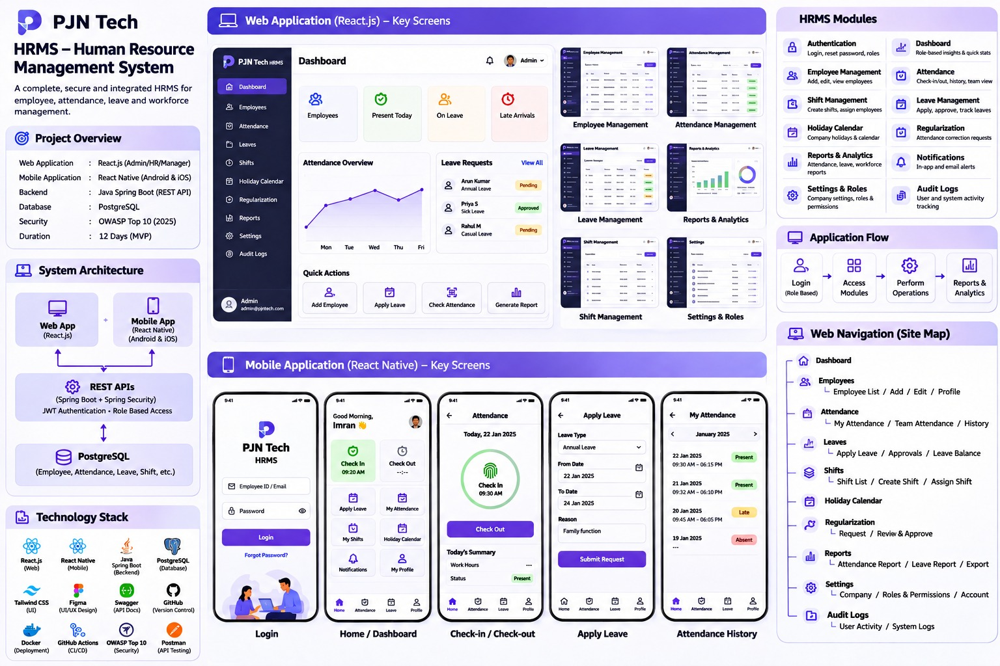

# PJN TECH HRMS
## DAY 1  |  FIGMA-STYLE UI DESIGN HANDOFF
**Assigned developer:** Karthick   •   **Mobile app:** React Native + Expo (TypeScript)   •   **16 November 2026**  
**Design reference:** supplied PJN Tech HRMS architecture and key-screens image (Mobile Application section). This is a design specification, not an editable Figma file.

### Today’s design output
| Screen | Required result | Priority |
| :--- | :--- | :--- |
| **Mobile Login / Authentication** | Complete responsive mobile login visual, form inputs, password toggle, and validation states | P0 |
| **Employee Home / Dashboard** | Greeting header, check-in/out preview cards, quick action grid, bottom tab bar shell | P0 |
| **Attendance & Check-In / Out (Foundation)** | Geofence status visual (100m in-house indicator), circular check-in action ring, work hours summary | P1 |
| **Shared mobile components** | Navigation stack + bottom tab bar, status pill badges, primary & secondary buttons, card containers | P0 |

**Scope boundary:** UI only using isolated mock data and mock location states. Do not implement live GPS geofencing, real JWT token storage, backend Spring Boot API calls, or database operations today.

---

### 01  Login screen – mobile frame specification

#### Figma frame specification
| Element | Visual and behavior specification |
| :--- | :--- |
| **Mobile frame** | 390 × 844 reference (iPhone 14 / modern Android 412 × 915 viewport); centered brand container with 24 px horizontal padding |
| **Brand** | Centered PJN Tech logo icon, "PJN Tech" title in bold navy (`#161A3D`), and "HRMS" subtitle in muted slate |
| **Fields** | • Employee ID / Email input field with placeholder • Password input field with eye icon password-visibility toggle |
| **Actions** | • Primary "Login" button (full width, primary purple fill `#6338DF`, white text, 12 px rounded) • "Forgot Password?" text link centered below button |
| **States** | Default, focused border (`#6338DF`), validation error (red border + helper text), submitting/loading indicator (`ActivityIndicator`) |
| **Navigation** | Successful login demo action routes to Mobile Home / Dashboard using explicitly labeled mock credentials |

#### Layout wireframe
| PJN Tech HRMS  •  Mobile Login |
| :--- |
| `[  PJN Tech Logo  ]` |
| **PJN Tech** |
| *HRMS* |
| Employee ID / Email `[ 👤  emp@pjntech.com      ]` |
| Password            `[ 🔒  ••••••••••••••••  👁 ]` |
| `[                 Login                 ]` |
| *Forgot Password?* |

---

### 02  Mobile application shell & navigation

| Bottom Navigation Bar (Tabs) | Top Header Bar | Main Viewport Region |
| :--- | :--- | :--- |
| • **Home** (icon + label, active purple) • **Attendance** (icon + label) • **Leave** (icon + label) • **Profile** (icon + label) | • Contextual screen title or personalized greeting • User avatar thumbnail • Notification bell with unread dot | • Safe Area Inset compliant (`SafeAreaView`) • Scrollable view (`ScrollView`) to prevent keyboard clipping • Soft background `#F7F7FC` |

> **Navigation rule:** Navigation tabs or cards for subsequent modules (*Apply Leave*, *My Attendance*, *My Shifts*, *Holiday Calendar*) may open an intentional "Coming Soon" or mock placeholder view. No broken touch handlers or unhandled route crashes.

---

### 03  Home / Dashboard screen

| Section | Required UI |
| :--- | :--- |
| **Header greeting** | "Good Morning, Imran 👋", employee avatar, notification bell icon |
| **Attendance quick widget** | Dual status cards side-by-side: • **Check In**: Green checkmark icon, "09:20 AM" • **Check Out**: Clock icon, "--:--" |
| **Quick Action Grid (2 × 3)** | 6 tap cards with icons & labels: 1. **Apply Leave** (calendar icon) 2. **My Attendance** (clock-history icon) 3. **My Shifts** (calendar-clock icon) 4. **Holiday Calendar** (sun/holiday icon) 5. **Notifications** (bell icon) 6. **My Profile** (user icon) |
| **Bottom Tab Bar** | Fixed persistent bar: **Home** (active `#6338DF`), **Attendance**, **Leave**, **Profile** |
| **Responsive** | Fits comfortably on 390 × 844; gracefully scrolls on smaller devices (e.g. iPhone SE 667 px) |

---

### 04  Check-in / Check-out & Attendance screen (Foundation)

| Section | Required UI |
| :--- | :--- |
| **Header** | Back button / tab header, "Attendance" title, current date label (**"Today, 22 Jan 2025"**) |
| **In-House Geofence pill** | Mock status pill: "📍 Inside Office Geofence (100m validated)" |
| **Circular action ring** | Large centered circular touch ring: • Outer green active ring (`#10B981`) • Inner check icon • Label: **"Check In"** • Timestamp: **"09:30 AM"** |
| **Primary action button** | Full-width purple pill button: **"Check Out"** (or disabled state before check-in) |
| **Today's Summary card** | White rounded card with 2 columns: • **Work Hours:** "08h 45m" (or mock dynamic timer) • **Status:** Green pill badge **[Present]** |

---

### 05  Visual design tokens & Mobile guidelines

| Token | Suggested value / rule |
| :--- | :--- |
| **Primary purple** | `#6338DF` (brand primary for CTA buttons, active tabs, selected states) |
| **Deep navy text** | `#161A3D` (headings, titles, heavy emphasis) |
| **Page background** | `#F7F7FC` (soft off-white for mobile screen contrast) |
| **Cards & containers** | `#FFFFFF`, border `1px solid #ECECF2`, 16 px corner radius, subtle shadow (`elevation: 2`) |
| **Status colors** | • **Present / Approved:** `#10B981` (Green) • **Late / Pending:** `#F59E0B` (Amber) • **Absent / Rejected:** `#EF4444` (Red) |
| **Typography** | System default (San Francisco on iOS / Roboto on Android) or Inter; Titles 20–24 px; Body 14–16 px; Captions 12 px |
| **Touch target sizing** | Minimum 44 × 44 pt on iOS / 48 × 48 dp on Android for all interactive touch targets |
| **Safe area handling** | Mandatory `SafeAreaProvider` + `useSafeAreaInsets` for notch, dynamic island, and home indicator |

---

### 06  Implementation and handoff checklist
- [ ] Create feature branch `feat/hrms-mobile-day1-karthick`
- [ ] Initialize Expo project with TypeScript template (`npx create-expo-app --template typescript`)
- [ ] Configure React Navigation (`@react-navigation/native`, `@react-navigation/native-stack`, `@react-navigation/bottom-tabs`)
- [ ] Setup design token constants (Colors, Typography, Spacing, Shadows)
- [ ] Build reusable mobile layout shell (SafeArea wrapper, header bar, bottom tab bar)
- [ ] Implement Mobile Login screen with full mock states (default, focus, error, loading)
- [ ] Implement Mobile Home / Dashboard screen with greeting, dual check cards, and 6 quick-action tiles
- [ ] Implement foundational Attendance Check-In / Out layout with circular indicator and summary card
- [ ] Test on iOS simulator (iPhone 14 / 390 × 844) and Android emulator (1080 × 2400)
- [ ] Verify keyboard dismissal on tap outside and smooth scrolling without clipped bottom tabs
- [ ] Submit pull request with screen recordings/screenshots and clean TypeScript build

---

### Definition of done – 5:30 PM review
Show the mobile application running on iOS and Android simulators/devices. The bottom tab navigation switches smoothly, the Login screen validates inputs and transitions to Home, the Dashboard displays the personalized greeting and quick action grid, and the Attendance preview screen renders the circular check-in ring and summary card. Share GitHub PR link, screenshots/screen recording, setup instructions, completed items, and blockers.

**Next development step:** Day 2 Mobile Authentication screens (Forgot Password, OTP verification) and geofence permission flow foundation. Live GPS coordinates and backend 100m distance validation will be integrated with Anuvrath's attendance service.
