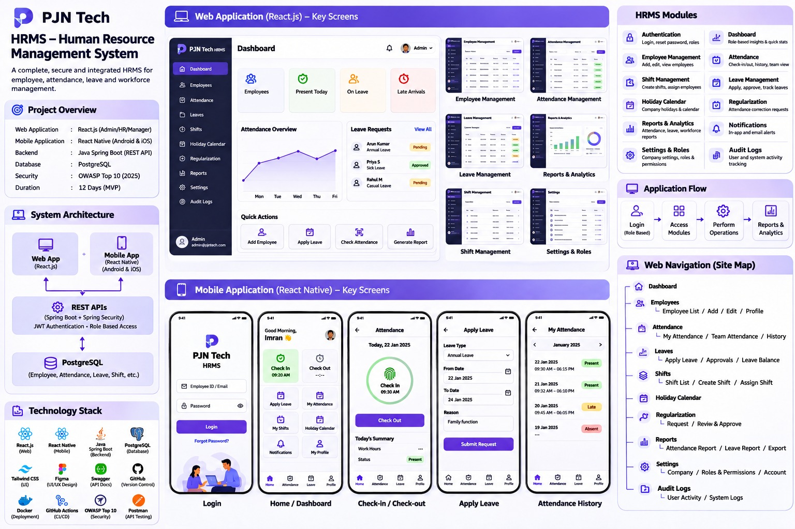

# PJN TECH HRMS
## DAY 1  |  FIGMA-STYLE UI DESIGN HANDOFF
**Assigned developer:** Jagadeesh   •   **Web frontend:** React.js + TypeScript   •   **16 November 2026**  
**Design reference:** supplied PJN Tech HRMS architecture and key-screens image. This is a design specification, not an editable Figma file.

### Today’s design output
| Screen | Required result | Priority |
| :--- | :--- | :--- |
| **Login / Authentication** | Complete responsive login visual and input states | P0 |
| **Admin / HR Dashboard** | Complete main shell, KPI cards, chart, requests, quick actions | P0 |
| **Employee Management** | Employee list/table shell with search and filters | P1 |
| **Shared components** | Sidebar, header, buttons, inputs, cards, badges, empty states | P0 |

**Scope boundary:** UI only using isolated mock data. Do not implement real login, GPS attendance, role enforcement or backend/database operations today.

---

### 01  Login screen – desktop and mobile

#### Figma frame specification
| Element | Visual and behavior specification |
| :--- | :--- |
| **Desktop frame** | 1440 × 900 reference; centered two-column composition or centered login card |
| **Mobile frame** | 390 × 844 reference; single column with comfortable padding |
| **Brand** | PJN Tech logo and HRMS title; white/light background with purple primary accent |
| **Fields** | Employee ID / Email; Password with eye visibility control |
| **Actions** | Primary Login button; Forgot Password link |
| **States** | Default, focus, required-field error, invalid credentials mock state, submitting/loading |
| **Navigation** | Successful demo action may route to dashboard using explicitly labeled mock mode only |

#### Layout wireframe
| PJN Tech HRMS  •  Login |
| :--- |
| **Logo + “PJN Tech HRMS”** |
| Employee ID / Email `[____________________]` |
| Password `[_________________ ◉]` |
| `[               LOGIN               ]` |
| *Forgot Password?* |
| *Optional illustration / welcoming HRMS visual* |

---

### 02  Web application shell

| Sidebar (fixed desktop / drawer mobile) | Top bar | Content region |
| :--- | :--- | :--- |
| • PJN Tech logo • Dashboard • Employees • Attendance • Leaves • Shifts • Holiday Calendar • Regularization • Reports • Settings • Audit Logs | • Page title • Notifications icon • Admin/HR avatar menu | • Responsive page content • Scrollable main area • Cards and tables |

> **Navigation rule:** Navigation links for later modules may open an intentional “Coming soon” page. No broken links or dead clicks.

---

### 03  Dashboard screen

| Section | Required UI |
| :--- | :--- |
| **Header** | “Dashboard” title, notification bell, profile dropdown |
| **KPI row** | Employees • Present Today • On Leave • Late Arrivals |
| **Attendance Overview** | Five-day line chart with Mon–Fri labels; mock series |
| **Leave Requests** | Three mock requests, employee name, leave type, Pending/Approved badge, View All |
| **Quick Actions** | Add Employee • Apply Leave • Check Attendance • Generate Report |
| **Responsive** | Desktop 4 KPI columns; tablet 2; phone 1–2 based on available width |

---

### 04  Employee Management – list screen

| Section | Required UI |
| :--- | :--- |
| **Page heading** | Employee Management; Add Employee primary button |
| **Toolbar** | Search by name/ID; department and status filters |
| **Table columns** | Employee ID, Name, Department, Designation, Email, Status, Actions |
| **Table behavior** | Mock pagination; loading skeleton; no-results and empty states |
| **Actions** | View/Edit buttons may open UI-only placeholders, clearly marked |
| **Responsive** | Horizontal table scrolling or stacked employee cards on small screens |

---

### 05  Visual design tokens

| Token | Suggested value / rule |
| :--- | :--- |
| **Primary purple** | `#6338DF` (approximate; confirm against approved Figma brand file) |
| **Deep sidebar** | `#161A3D` |
| **Page background** | `#F7F7FC` |
| **Cards** | `#FFFFFF`, subtle gray border, 12 px radius |
| **Typography** | Inter or equivalent clean sans-serif; headings 24–28 px; body 14–16 px |
| **Spacing** | 8 px spacing scale; 24 px content gutters desktop; 16 px mobile |
| **Status** | Green present/approved, amber pending/late, red absent/error |
| **Accessibility** | Visible keyboard focus, accessible labels, sufficient contrast |

---

### 06  Implementation and handoff checklist
- [ ] Create feature branch `feat/hrms-web-day1-jagadeesh`
- [ ] Initialize Vite React + TypeScript, Tailwind, React Router
- [ ] Build reusable app shell (Sidebar, Header, ContentLayout)
- [ ] Implement Login UI with all mock states
- [ ] Implement Dashboard UI with sample chart and requests
- [ ] Implement Employee List UI with mock records
- [ ] Check 1440 px desktop, 768 px tablet, 390 px phone
- [ ] Verify navigation, no TypeScript errors and no browser console errors
- [ ] Submit screenshots for each screen, a running demo and pull request

---

### Definition of done – 5:30 PM review
Show the login, dashboard and employee list at desktop and mobile sizes. The sidebar navigation works, KPI cards and chart render mock data, filters/search work on mock employee records, and each state is visually coherent. Share GitHub PR, screenshots, setup instructions, completed items and blockers.

**Next development step:** Employee Add/Edit/Profile UI and backend contract alignment. Actual authorization and tenant isolation must be implemented and validated with the backend team; a hidden menu is not a security control.
